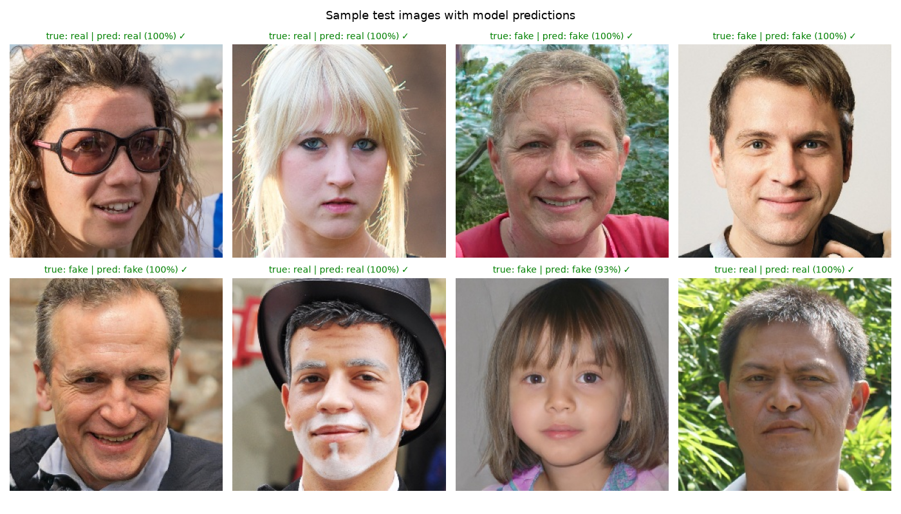
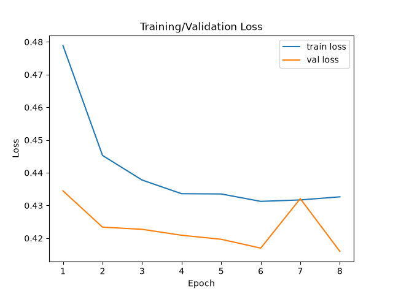
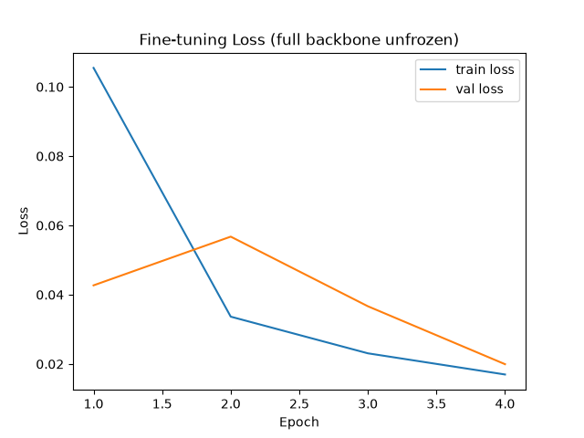
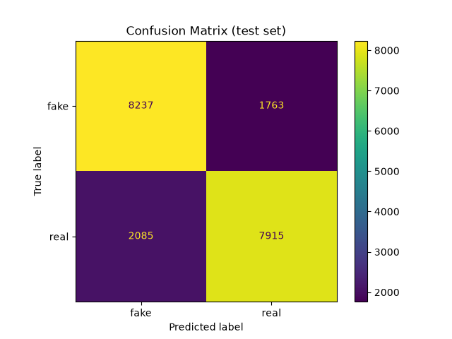
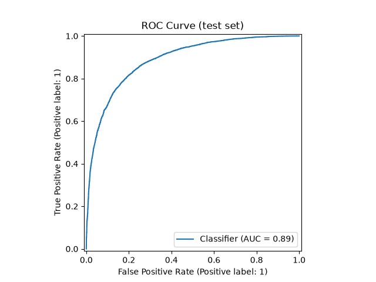
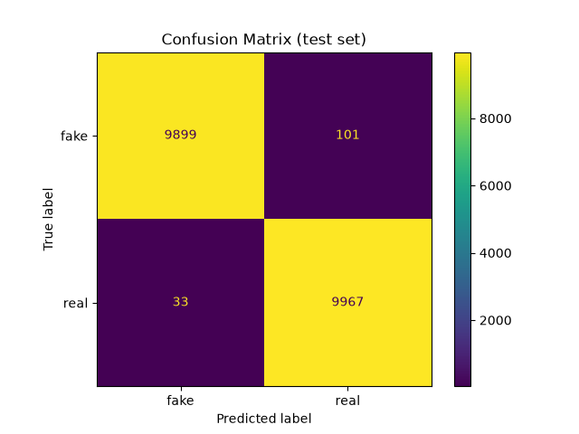
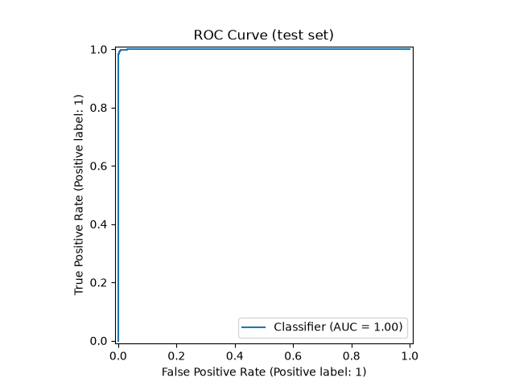

# Deepfake Face Detector

A real, honestly-documented rebuild of a deepfake image classifier — every
number below comes from actually running this code, not from an
undocumented claim.

See also: [MODEL_CARD.md](MODEL_CARD.md) (standardized model
documentation) and [REPORT.md](REPORT.md) (a full rewritten report in the
style of an academic paper).

## What this is (and isn't)

- **Is**: a binary image classifier (real vs. GAN-generated fake face)
  fine-tuned from a pretrained ResNet18.
- **Isn't**: a video/temporal detector (no RNN — the dataset is single
  images, so a temporal model would have nothing to analyze) or a
  federated-learning system (single machine, single dataset).

## Sample Predictions

Random test images with the trained model's actual predictions
(`src/visualize_samples.py`):



## Dataset

[`xhlulu/140k-real-and-fake-faces`](https://www.kaggle.com/datasets/xhlulu/140k-real-and-fake-faces)
— 140,000 face images: real photos from Flickr-Faces-HQ, fakes generated by
StyleGAN. The dataset ships with its own `train/valid/test` split, balanced
50/50 real vs. fake in every split (100,000 train / 20,000 valid /
20,000 test). The full dataset is used — no subsampling. See
`src/download_data.py`.

Labels use the dataset's own convention: **1 = real, 0 = fake**.

## Model

`torchvision.models.resnet18`, pretrained on ImageNet, with a new
`Linear(512, 1)` head, trained with `BCEWithLogitsLoss` (binary: 1 = real,
0 = fake). See `src/model.py`. Two checkpoints are provided:

- **Frozen-head** (`outputs/checkpoints/best_model.pt`): only the head is
  trained, backbone stays at ImageNet weights.
- **Fine-tuned** (`outputs/checkpoints/best_model_finetuned.pt`):
  continued from the frozen-head checkpoint with the full backbone
  unfrozen at a lower learning rate (`src/train_finetune.py`).

## Training

| | Frozen-head | Fine-tuned |
|---|---|---|
| Optimizer | Adam, lr=1e-3 | Adam, lr=1e-4 |
| Batch size | 32 | 32 |
| Epochs | 8 | 4 |
| Trainable params | head only | full network |
| Device | Apple M3 GPU (MPS) | Apple M3 GPU (MPS) |

Best checkpoint in each stage selected by validation accuracy.

**Frozen-head** (`outputs/history.json`):



| Epoch | Train Loss | Train Acc | Val Loss | Val Acc |
|-------|-----------|-----------|----------|---------|
| 1 | 0.479 | 0.771 | 0.435 | 0.798 |
| 2 | 0.445 | 0.793 | 0.423 | 0.805 |
| 3 | 0.438 | 0.798 | 0.423 | 0.805 |
| 4 | 0.434 | 0.800 | 0.421 | 0.807 |
| 5 | 0.434 | 0.799 | 0.420 | 0.810 |
| **6** | 0.431 | 0.800 | 0.417 | **0.811** (best) |
| 7 | 0.432 | 0.801 | 0.432 | 0.803 |
| 8 | 0.433 | 0.799 | 0.416 | 0.809 |

**Fine-tuned, full backbone unfrozen** (`outputs/history_finetuned.json`):



| Epoch | Train Loss | Train Acc | Val Loss | Val Acc |
|-------|-----------|-----------|----------|---------|
| 1 | 0.106 | 0.959 | 0.043 | 0.984 |
| 2 | 0.034 | 0.988 | 0.057 | 0.980 |
| 3 | 0.023 | 0.991 | 0.037 | 0.987 |
| **4** | 0.017 | 0.994 | 0.020 | **0.994** (best) |

## Test Set Results

Evaluated once, on the full held-out 20,000-image test split
(`src/evaluate.py`). "Positive" class is 1 = real, per the dataset's
convention:

| Metric | Frozen-head (`outputs/metrics.json`) | Fine-tuned (`outputs/metrics_finetuned.json`) |
|--------|-------|-------|
| Accuracy | 0.808 | **0.993** |
| Precision | 0.818 | 0.990 |
| Recall | 0.792 | 0.997 |
| F1 | 0.804 | 0.993 |
| ROC-AUC | 0.889 | 0.9998 |

Frozen-head plots:  

Fine-tuned plots:  

## Honest limitations

- Unfreezing the backbone raised accuracy from 80.8% to 99.3% — but this
  is an **in-distribution** result: all fakes (train and test) come from
  the same StyleGAN pipeline. This is a well-known property of this
  dataset — a fine-tuned CNN can key in on that specific generator's
  artifacts — and is not evidence the model would generalize to other
  generation methods (diffusion models, other GANs, video/face-swap
  deepfakes). No cross-dataset generalization test has been run.
- This dataset's fakes are all StyleGAN-generated still images; the model
  has not been tested against other generation methods and shouldn't be
  assumed to generalize to those.

## Reproducing

```bash
python3 -m venv .venv
source .venv/bin/activate
pip install -r requirements.txt

# requires ~/.kaggle/kaggle.json with your Kaggle API credentials
python src/download_data.py
python src/train.py
python src/evaluate.py

# optional: fine-tune the full backbone from the frozen-head checkpoint
python src/train_finetune.py
python src/evaluate.py --checkpoint outputs/checkpoints/best_model_finetuned.pt --tag finetuned
```

## Try it yourself (local demo)

```bash
python app.py
```

Opens a local Gradio UI — upload a face photo and get a real/fake
prediction with confidence. Uses the fine-tuned checkpoint if present,
otherwise falls back to the frozen-head one.
