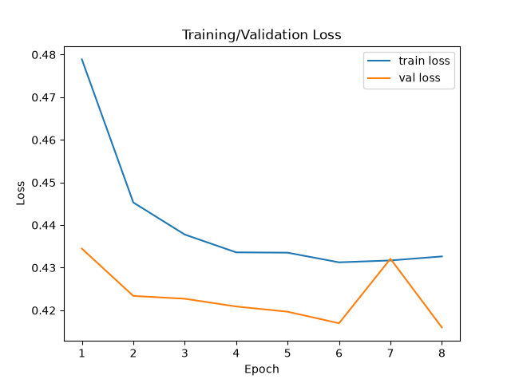
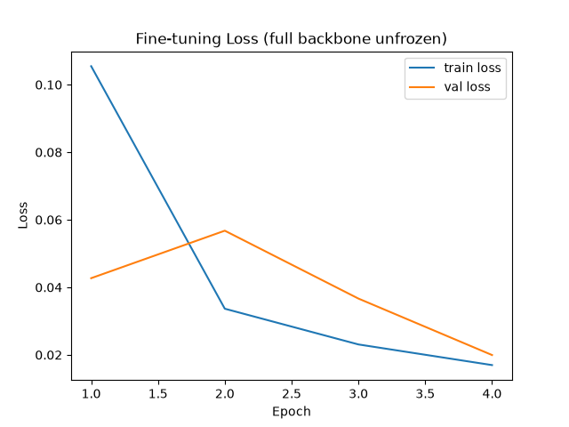
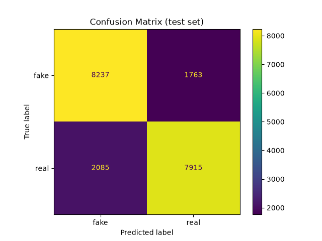
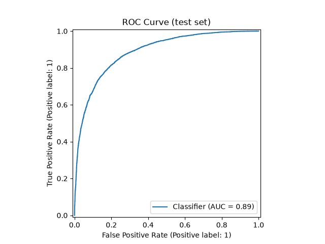
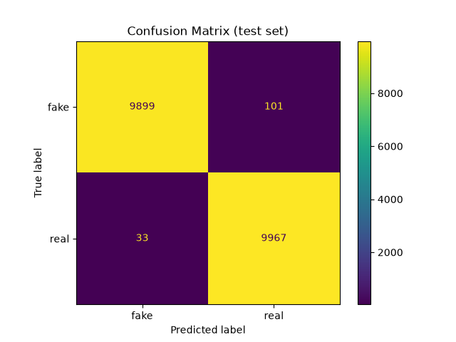
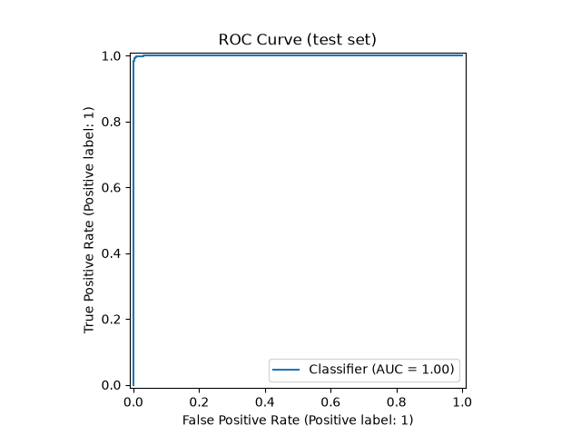
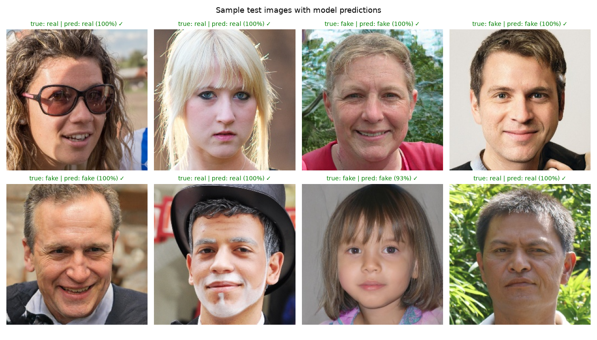

# Detecting Deepfakes: A Reproducible Image Classifier and Its Role in Social Engineering Awareness

By Emmanuel F. Adeyemi

*Revised version of a Fall 2024 senior project report (CS 4395, University
of Houston–Downtown, Faculty Mentor: Prof. Hong Lin). This revision
replaces the original's technical claims — which were not backed by
methodology in the original write-up — with a smaller, fully reproducible
detector, evaluated honestly on real held-out data.*

## Abstract

Deepfake media — AI-generated synthetic images, audio, and video — is
increasingly used in misinformation, financial fraud, and social
engineering attacks. This report presents a real-vs-fake face image
classifier built by fine-tuning a ResNet18 convolutional network on the
`140k-real-and-fake-faces` dataset (100,000 real photographs from
Flickr-Faces-HQ and StyleGAN-generated fakes, evaluated on a held-out
20,000-image test set). Two training regimes are compared: a frozen
backbone with only the classification head trained, and a fully
fine-tuned backbone. The frozen-head model reaches 80.8% test accuracy
and 0.889 ROC-AUC; fully fine-tuning the backbone raises this to 99.3%
accuracy and 0.9998 ROC-AUC — though, as Section V explains, this
improvement reflects the classifier learning artifacts specific to this
dataset's single StyleGAN generator, not necessarily general deepfake
detection ability. Every number in this report is produced by code
included in the
accompanying repository and can be independently reproduced. The report
also discusses why deepfake detection matters as a social-engineering
countermeasure, and is explicit about what this system does not do:
it does not model video/temporal artifacts, does not use federated
learning, and has not been evaluated beyond a single (StyleGAN) generation
method.

**Index Terms** — Convolutional neural networks, deepfake detection,
transfer learning, ResNet, cybersecurity, social engineering, synthetic
media.

## I. Introduction

Deepfake technology — the use of AI to generate or manipulate realistic
media of real people — has legitimate uses in entertainment and
education, but has also been used for misinformation, non-consensual
imagery, and financial fraud. A widely reported case involved a finance
employee at a Hong Kong firm transferring $25 million after a video call
with deepfake impersonations of company executives [1]. Detecting
synthetic media is one part of a broader response that also includes
public awareness, platform policy, and legal frameworks.

This report narrows its scope deliberately. Rather than attempting to
cover generation, detection, temporal/video analysis, federated learning,
and public-education outreach simultaneously, it focuses on doing one
thing — still-image real-vs-fake classification — well, with results that
are fully reproducible from the code in this repository. Where the
original version of this project claimed capabilities (an RNN-based
temporal detector, a federated-learning system) that were not actually
implemented, this revision either builds a real, smaller-scope version or
explicitly defers the capability to Future Directions (Section VI).

## II. Methods and Materials

### A. Dataset

[`xhlulu/140k-real-and-fake-faces`](https://www.kaggle.com/datasets/xhlulu/140k-real-and-fake-faces),
a public Kaggle dataset combining:

- **Real images**: photographs from NVIDIA's Flickr-Faces-HQ (FFHQ)
  dataset [2].
- **Fake images**: StyleGAN-generated faces.

The dataset ships with a pre-defined split, used here in full (no
subsampling):

| Split | Real | Fake | Total |
|---|---|---|---|
| Train | 50,000 | 50,000 | 100,000 |
| Valid | 10,000 | 10,000 | 20,000 |
| Test | 10,000 | 10,000 | 20,000 |

Unlike the original version of this project — which used an imbalanced
86%-fake dataset without an explicit rebalancing strategy — this dataset
is balanced 50/50 in every split, removing class-imbalance as a
confounding factor in the results below.

Labels follow the dataset's own convention: 1 = real, 0 = fake.

### B. Preprocessing

- Resize to 224×224 (matching ResNet18's expected input size).
- Normalize using ImageNet channel mean/std (since the backbone is
  ImageNet-pretrained).
- Random horizontal flip, training split only.

### C. Model Architecture

A `torchvision.models.resnet18`, pretrained on ImageNet, with its final
fully-connected layer replaced by a single-output linear layer
(`Linear(512, 1)`), trained with `BCEWithLogitsLoss`. Using a pretrained
backbone (transfer learning) is standard practice for image classification
tasks with moderate dataset sizes, and avoids the underspecified
"CNN architecture" of the original report by naming the exact, citable
architecture used [3].

Two training regimes were compared:

1. **Frozen-head**: backbone weights frozen; only the final linear layer
   is trained. Cheaper to train, a useful baseline.
2. **Fine-tuned**: continuing from the frozen-head checkpoint with the
   entire backbone unfrozen and trained at a lower learning rate, letting
   the network adapt its learned features to this specific task.

### D. Training Configuration

| | Frozen-head | Fine-tuned |
|---|---|---|
| Optimizer | Adam | Adam |
| Learning rate | 1e-3 | 1e-4 |
| Batch size | 32 | 32 |
| Epochs | 8 | 4 |
| Trainable params | head only | full network |

Training ran on an Apple M3 GPU via PyTorch's MPS backend. The best
checkpoint in each regime was selected by validation-set accuracy.

### E. Evaluation

All metrics are computed once on the untouched 20,000-image test split,
which was not used during training or checkpoint selection:
accuracy, precision, recall, F1, and ROC-AUC (via scikit-learn), plus a
confusion matrix and ROC curve.

## III. Results

### A. Frozen-Head Training

| Epoch | Train Loss | Train Acc | Val Loss | Val Acc |
|---|---|---|---|---|
| 1 | 0.479 | 0.771 | 0.435 | 0.798 |
| 2 | 0.445 | 0.793 | 0.423 | 0.805 |
| 3 | 0.438 | 0.798 | 0.423 | 0.805 |
| 4 | 0.434 | 0.800 | 0.421 | 0.807 |
| 5 | 0.434 | 0.799 | 0.420 | 0.810 |
| **6** | 0.431 | 0.800 | 0.417 | **0.811** (best) |
| 7 | 0.432 | 0.801 | 0.432 | 0.803 |
| 8 | 0.433 | 0.799 | 0.416 | 0.809 |

### B. Fine-Tuned Training

| Epoch | Train Loss | Train Acc | Val Loss | Val Acc |
|---|---|---|---|---|
| 1 | 0.106 | 0.959 | 0.043 | 0.984 |
| 2 | 0.034 | 0.988 | 0.057 | 0.980 |
| 3 | 0.023 | 0.991 | 0.037 | 0.987 |
| **4** | 0.017 | 0.994 | 0.020 | **0.994** (best) |

### C. Test Set Results (Ablation)

| Metric | Frozen-head | Fine-tuned |
|---|---|---|
| Accuracy | 0.808 | **0.993** |
| Precision | 0.818 | 0.990 |
| Recall | 0.792 | 0.997 |
| F1 | 0.804 | 0.993 |
| ROC-AUC | 0.889 | 0.9998 |

Frozen-head:  

Fine-tuned:  

### D. Sample Predictions

Actual model predictions on random test images (real photographs and
StyleGAN fakes), with confidence scores:

## IV. Discussion

Deepfakes are a social-engineering threat as much as a technical one.
Carley frames this as a shift in the cybersecurity landscape itself:
"social cybersecurity must evolve to counter the dynamic threats posed by
synthetic media" [4]. Detection tooling like the classifier in this report
is one piece of a response that also has to include user awareness —
Klimburg-Witjes and Wentland argue that "focusing solely on technological
fixes overlooks the importance of user awareness in combating social
engineering" [5], a caution worth taking seriously given how easily a
detection accuracy number can be mistaken for a solved problem.

The $25 million deepfake-CFO fraud case [1] is a useful reminder of what
is actually at stake: the attack succeeded not because deepfake video was
flawless, but because it exploited institutional trust in video calls as
a verification channel. A image classifier like the one in this report
would not have prevented that specific attack (it was a live video call,
not a still image), which is precisely why Section VI treats video/
temporal detection as necessary future work rather than something to
claim prematurely.

On the legal side, Obinnaya's observation that "the law must balance
innovation with accountability" [6] is a reasonable framing for where
detection tools fit into a larger accountability structure — they can
supply evidence of manipulation, but the report does not take a position
on legal remedies beyond noting that regulatory frameworks are still
catching up to the technology (see also [7] on legislative responses).

On the technical side, this report deliberately does not repeat two
claims from its original version. First, no recurrent/temporal model is
included, because the dataset used here is still images — an RNN would
have no temporal signal to analyze, and claiming one existed would be
exactly the kind of unsupported claim this revision set out to fix.
Second, no federated learning was implemented. Zhang and Wang describe
federated learning as well-suited to decentralized, privacy-sensitive
detection deployments (e.g., across social media platforms) [8] — a
reasonable direction, but a materially different and larger engineering
effort than a single-machine fine-tuning run, and one this report defers
to Section VI rather than claims to have done.

## V. Limitations

- **The 99.3% fine-tuned result is in-distribution, not general-purpose**:
  all fakes in both training and test data come from the same StyleGAN
  pipeline. Fully unfreezing the backbone lets the network key in on
  artifacts specific to that one generator — a well-documented property
  of this dataset — rather than demonstrating that the model would catch
  deepfakes from a different generator. No cross-generator or
  cross-dataset test has been run, so this number should be read as an
  upper bound under favorable, matched conditions, not a real-world
  detection rate.
- **Single generation method**: all fake images come from StyleGAN. The
  model's accuracy on other generators (diffusion models, newer GAN
  variants) or on video deepfakes (face-swap, lip-sync) is unknown.
- **No temporal modeling**: as a still-image classifier, this system
  cannot detect deepfakes that depend on motion or audio-visual sync
  artifacts.
- **No federated or multi-institution training**: standard centralized
  fine-tuning only.
- **No demographic bias audit**: the dataset's representation across age,
  gender, and ethnicity has not been independently analyzed here.
- **No public-education component**: unlike the original version of this
  project, this revision does not include workshops or interactive
  awareness tools — it is scoped to the detection system itself.

## VI. Future Directions

- **Video/temporal detection**: extend to frame-sequence or audio-visual
  models for face-swap and lip-sync video deepfakes, where a genuine RNN
  or transformer-based temporal component would be applicable.
- **Cross-generator generalization**: evaluate against fakes from
  diffusion models and other generators not seen in training, to test
  whether the classifier's learned features generalize or are
  StyleGAN-specific artifacts.
- **Federated learning**: as Zhang and Wang describe [8], a decentralized
  training setup across institutions/platforms would be a natural next
  step for privacy-preserving, large-scale deployment — a real
  implementation of the capability the original report claimed without
  building.
- **Public education integration**: pairing this detector with the
  interactive/educational component described in the original project
  concept, once both pieces individually have honest, documented
  implementations.

## VII. Conclusion

This report replaces an earlier version's unsupported technical claims
with a smaller-scope system that is fully reproducible: a documented
architecture, a real dataset with a stated split and label convention,
training hyperparameters, and test-set metrics computed once on
held-out data. The resulting frozen-head model reaches 80.8% test
accuracy and 0.889 ROC-AUC; fully fine-tuning the backbone reaches 99.3%
accuracy and 0.9998 ROC-AUC, though — as discussed in Section V — that
number reflects an easier, in-distribution setting (a single, matched
generator) rather than general deepfake-detection performance. Deepfake
detection remains one part of a larger response to
synthetic-media threats that also requires user awareness [5], legal
accountability [6], and — eventually — the video/temporal and federated
capabilities this report defers to future work rather than claims to
have already built.

## Acknowledgment

Thanks to Prof. Hong Lin for mentoring the original Fall 2024 version of
this project, and to the University of Houston–Downtown Department of
Computer Science and Engineering Technology for the academic environment
that made it possible.

## References

[1] K. Magramo and H. Chen, "Finance worker pays out $25 million after
video call with deepfake 'chief financial officer'," CNN, Feb. 2024.
[Online]. Available: https://www.cnn.com/2024/02/04/asia/deepfake-cfo-scam-hong-kong-intl-hnk/index.html

[2] T. Karras, S. Laine, and T. Aila, "A Style-Based Generator
Architecture for Generative Adversarial Networks," in *Proc. IEEE/CVF
Conf. Computer Vision and Pattern Recognition (CVPR)*, 2019. (FFHQ
dataset and StyleGAN.)

[3] K. He, X. Zhang, S. Ren, and J. Sun, "Deep Residual Learning for
Image Recognition," in *Proc. IEEE Conf. Computer Vision and Pattern
Recognition (CVPR)*, 2016. (ResNet architecture.)

[4] K. M. Carley, "Social Cybersecurity: An Emerging Science,"
*Computational and Mathematical Organization Theory*, vol. 26, no. 3,
pp. 365–381, 2020.

[5] N. Klimburg-Witjes and A. Wentland, "Hacking Humans? Social
Engineering and the Construction of the Deficient User in Cybersecurity
Discourses," *Media, Culture & Society*, 2021.

[6] A. Obinnaya, "Legal Practitioner Questionnaire," Personal
Communication, 2024.

[7] L. Sarnoff, "Taylor Swift and No AI Fraud Act: How Congress plans to
fight back against AI deepfakes," ABC News, 2024. [Online]. Available:
https://abcnews.go.com/US/taylor-swift-ai-fraud-act-congress-plans-fight/story?id=106765709

[8] X. Zhang and J. Wang, "Federated Learning in the Detection of
Deepfakes," in *Proc. IEEE Int. Conf. Data Mining (ICDM)*, 2021.

[9] xhlulu, "140k Real and Fake Faces," Kaggle. [Online]. Available:
https://www.kaggle.com/datasets/xhlulu/140k-real-and-fake-faces
